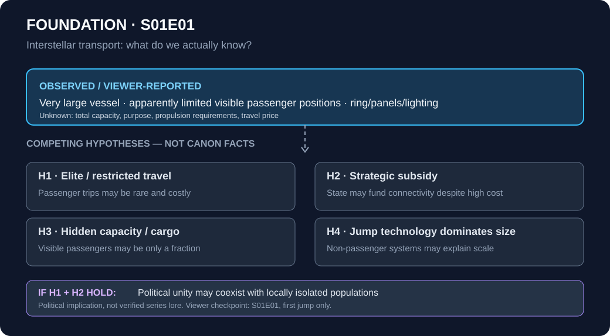

# Foundation Universe — analytical research notebook

**Canon:** Apple TV+ series only. **Strict current spoiler boundary:** **S01E01, through the first interstellar jump and ship exterior**; the episode has *not* been confirmed finished.

This is an **analysis-first** study of the depicted fictional civilization: technology, economic access, politics, social structure, and competing causal explanations. A compact encyclopedic record will support analyses as the viewer watches further. It is **not** an episode recap or an unrestricted fan wiki.

## Current investigation

### Who gets to travel between the stars?

The viewer noticed a striking scale mismatch: a huge jump-capable vessel, but seemingly few visible passenger positions. Does this imply **exclusive, expensive interstellar transport**, strategically subsidized routes, unknown additional capacity, or massive machinery required for a jump?

*Viewer-provided 2026-10-17 photograph of the displayed vessel; cropped/downsampled preview for repository transfer validation. This is direct visual evidence, not a generated or online promotional image.*

Read the [analysis of interstellar mobility and imperial cohesion](research/interstellar-mobility-and-imperial-cohesion.md), or the [S01E01 observation log](episodes/s01e01-observation-log.md).

**Important:** the series has not established the actual passenger capacity, operating costs, ticket prices or the function of the vessel's exterior panels. All explanations remain hypotheses.

### Why is an apparently permanent dynasty afraid of an idea?

The viewer has now observed **cloned emperors** and a violent imperial response apparently associated with someone reading Seldon. Does genetic succession protect continuity, or can suppressing unwelcome information undermine the system it aims to preserve?

See [genetic continuity, legitimacy and political repression](research/genetic-dynasty-and-political-repression.md). The exact circumstances of the reported killing and all wider consequences remain open questions.

## Research rules

- [Watched-content boundary and source policy](WATCHED_BOUNDARY.md): nothing from unwatched scenes, later episodes or books; no spoiler-leaking pictures.
- Observations, viewer testimony, character claims, inferences, alternatives and open questions must be distinguished.
- Preserve uncertainty and revision history rather than converting plausible interpretations into facts.
- Treat images, diagrams, screenshots and maps as evidence requiring the same checks as prose.

## Work style

The viewer's only routine contribution is **watching, talking about the series and optionally providing photographs**. The assistant maintains analytical notes, visuals, Markdown links, Git branches, pull requests and merges as part of ordinary discussion. No instructions to operate GitHub should be required after access is established.

This experiment has now demonstrated automated **text, SVG and a small binary JPEG preview** uploaded into GitHub from the viewer-supplied photograph. The image is intentionally cropped/downsampled for this first transport test; a robust, high-resolution image pipeline is **not yet validated**. Source images must never be silently replaced with unrelated or spoiler-prone internet images.

---

**Started:** 2026-10-17. **Viewer position:** S01E01 partial. **Status:** ongoing personal experiment.
