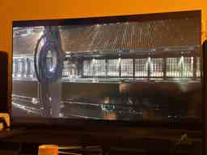

# S01E01 — Live observation log (partial)

**Boundary:** S01E01 in progress. Includes the first jump and vessel exterior, the viewer-reported cloned emperors, imperial violence linked to Seldon and the mathematically gifted young woman; **episode completion is NOT confirmed**.

## Observation O-001 — Passenger area versus vessel scale

- **Viewer observation:** only a relatively small number of passenger positions are visible in a ring around the center, despite the enormous vessel.
- **Visible in supplied exterior image:** a prominent ring-like element; repeated external panels; a long lit strip or compartment line.
- **Important distinction:** the ring-like exterior element has **not** been proven to be the same structure as the internal passenger positions, and no full passenger capacity has been confirmed.

## Observation O-002 — The cloned emperors

- **Viewer-reported:** the emperors are clones.
- **Analysis opened:** genetic replication might reinforce political continuity and a symbolically unchanging ruler, but shared DNA alone cannot guarantee identical decisions or personalities.
- **Unknown:** exact institutional rules, succession process, educational conditions and individual psychology.

## Observation O-003 — Violent response connected to Seldon

- **Viewer-reported:** an emperor kills someone apparently because that person was reading Seldon.
- **Uncertainty:** reading as sole motive is the viewer's initial interpretation, not yet a verified account of the complete circumstances.
- **Analysis opened:** suppression of a prediction can serve immediate regime legitimacy but might inhibit feedback and adaptation, potentially increasing structural weakness.
- **Do not infer:** the incident proves Seldon's theory correct or implies any later fate of the dynasty.

See [the genetic dynasty and repression analysis](../research/genetic-dynasty-and-political-repression.md).

## Observation O-004 — Mathematical challenge to Seldon

- **Viewer-reported (imperfect voice transcription):** a gifted young woman, understood to be Gaal Dornick, solved a difficult mathematical problem; others apparently believe she may be able to refute Seldon's calculations.
- **Uncertain:** exact problem, exact wording and intentions of those hoping for refutation.
- **Research distinction:** rigorous mathematical criticism tests assumptions and derivations; politically required refutation prescribes a conclusion.
- **No inference:** neither Seldon's rightness nor wrongness follows from Gaal's other mathematical achievement.

See [mathematical review versus political refutation](../research/mathematical-review-or-political-refutation.md).

### Viewer-provided visual evidence

*Source:* viewer-supplied phone photograph from the ongoing S01E01 discussion, 2026-10-17. **Cropped, downsampled preview** (not the full-resolution source). It shows a substantial external structure with a ring-like feature and repeated paneling. It does **not** establish the purpose of those elements or ship capacity.

## Research questions opened

1. Are jump vessels built around propulsion/jump systems rather than passenger accommodation?
2. Could the external panels serve thermal, structural, energy or other purposes? All unverified.
3. Is passenger interstellar travel expensive and exclusive?
4. Is imperial cohesion maintained by privileged mobility and/or subsidy, even if ordinary people seldom travel?
5. Might there be undisclosed passenger decks, cargo areas or other mixed uses?

## Theory status

- Elite/restricted travel — **open hypothesis**.
- Strategic subsidized interstellar service — **open hypothesis**.
- Higher-capacity / multi-use transport — **competing open hypothesis**.
- Technical requirements dominate vessel dimensions — **open hypothesis**.

See [mobility and imperial cohesion](../research/interstellar-mobility-and-imperial-cohesion.md) for the research assessment. Do not treat any of these as canonical facts.

**Entry origin:** 2026-10-17 live viewer discussion, not an external episode recap.
